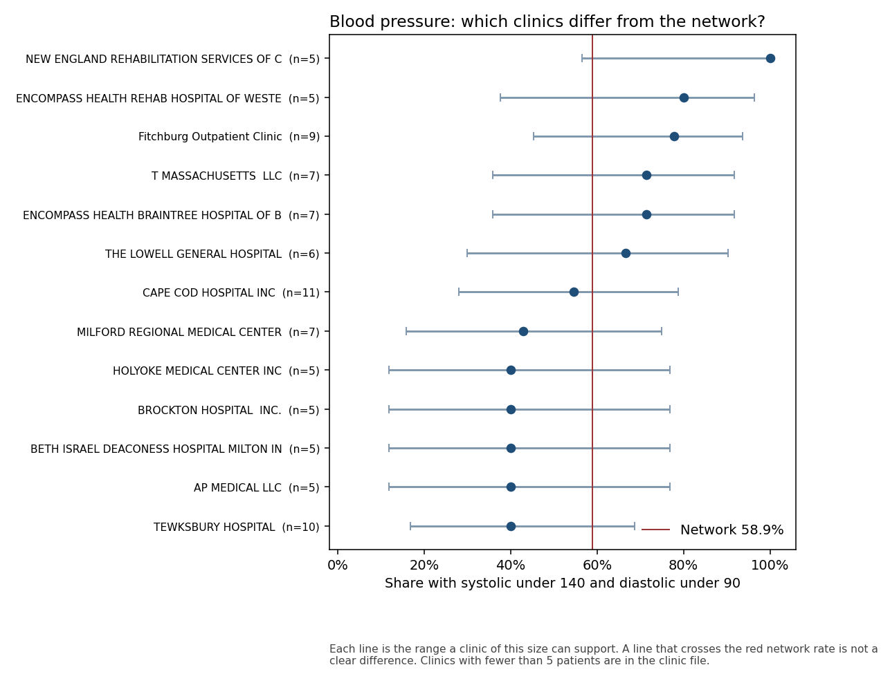
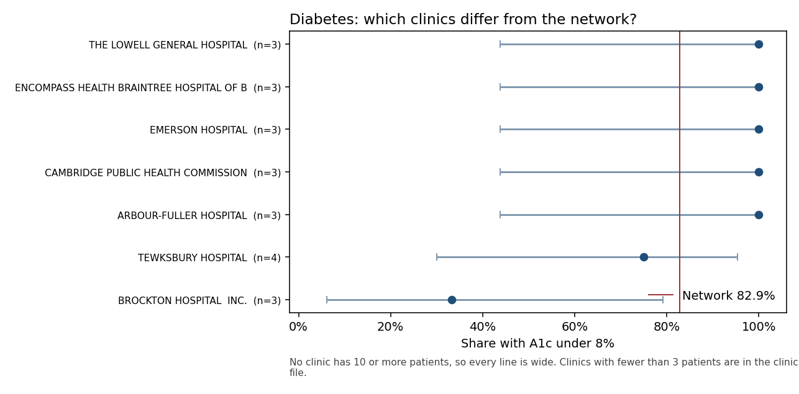
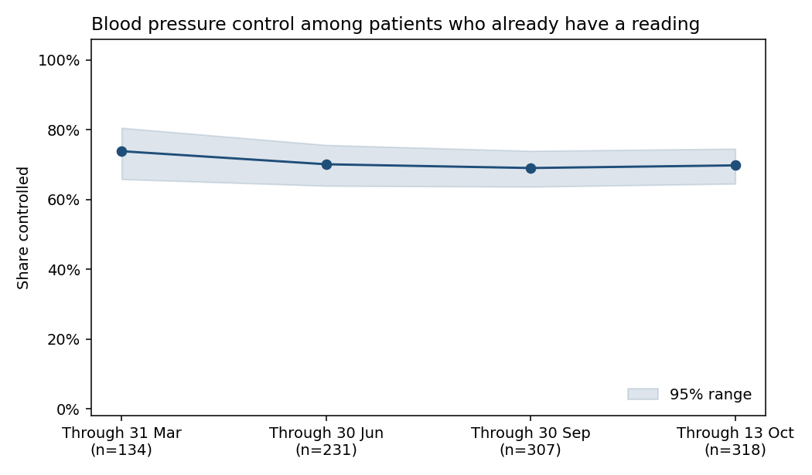
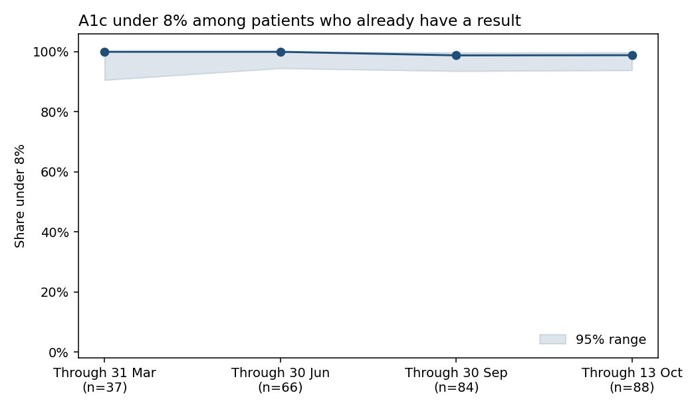

# Clinic report: 2026 blood pressure and diabetes rates

**To.** Clinic managers.
**From.** Research data analytics, for Dr. Maya Okafor.
**Date.** 14 October 2026.
**Window.** 1 January 2026 through 13 October 2026. The file ends on 13 October.

**Portfolio note.** Riverbend Community Health Network is illustrative. The patients are synthetic. These figures describe that file. They are not findings about real patients, and they are not a contract submission.

## Why this note exists

You asked whether a clinic is ahead of or behind the network. On this file, the clinics are too small to say. What you can use is the network rate, the range around it, and the count of patients with no result. A clinic whose line crosses the red network rate is not a ranking.

## How a patient got into the rate

Blood pressure includes adults age 18 to 85 who have high blood pressure on the problem list, who were alive through 13 October, and who had no hospice encounter. That is 377 people. Controlled means the latest usable reading in 2026 has a systolic (top number) under 140 and a diastolic (bottom number) under 90. Both have to be true. A reading of 138/92 is not controlled, and neither is 142/80. A systolic of exactly 140, or a diastolic of exactly 90, is not controlled. A person with no usable reading stays in the group and counts as not controlled.

Diabetes includes adults age 18 to 75 with type 2 diabetes on the problem list, on the same alive and hospice rules. That is 105 people. The result managers usually want is an A1c under 8%. A person with no A1c stays in the group and counts in the poor result.

The published contract versions of these measures need the diagnosis recorded on two different visits. This file stores each diagnosis once, on the day it started. Zero patients meet that visit rule. The rates below use the problem list so there is a number to look at. Dr. Okafor can call them a study rate. The contract measure still has nothing to report.

## The network

| | Patients | Result | Rate, and the range around it |
| --- | ---: | ---: | --- |
| Systolic under 140 and diastolic under 90 | 377 | 222 | 58.9% (53.9–63.7) |
| A1c under 8% | 105 | 87 | 82.9% (74.5–88.9) |

The range is the span a group of this size can support. A repeat of the same file could land anywhere inside it.

Of the 377 blood-pressure patients, 96 have a systolic of 140 or higher, or a diastolic of 90 or higher. Another 59 have no usable reading. Those 59 are inside the 58.9%.

Of the 105 diabetes patients, 17 have no A1c. None have an A1c over 9%. One person is between 8% and 9%. The poor result is the 17 people with no test.

Age and sex groups sit close to these network rates, and their ranges overlap. There is no age or sex group here that a manager should treat as a separate performance problem.

## Clinics

The dot is the clinic rate. The line is how wide that rate is allowed to be, given how few patients the clinic has. The red line is the network.

The 377 blood-pressure patients are spread across 165 organizations. The largest has 11 patients. None has 30. Two have at least 10, and both of those lines cross the network rate. One clinic of 3 patients has a line that misses the network rate. Three patients is not a reason to single out a site.

Another 31 blood-pressure patients had no visit in the window. They have no clinic and no reading, and they count as not controlled. They are not a site on this chart.

Diabetes patients are spread across 71 organizations. The largest has 4. One clinic of 3 patients, with 1 of those 3 under 8%, has a line that stops short of the network rate. That is the same situation: the line is wide because the clinic is small, and it is not a finding to act on.

The names on the charts are the organization with the most visits in the window. In this file that organization is often a hospital. Full names and every smaller site are in `outputs/bp_clinic_rates.csv` and `outputs/gsd_clinic_rates.csv`.

## Across the year

These two lines follow patients who already have a result. The number under each date is how many people had a result by then. The shaded band is the range around that measured group. People still waiting on a result are not on the line. They remain in the network rates above, counted as not meeting the goal.

Among people with a blood pressure, the share controlled moves from 73.9% at the end of March (134 people) to 69.8% by 13 October (318 people). The bands overlap. There is no drop a clinic should treat as a change in control. The network rate of 58.9% is lower than this line because 59 people never received a usable reading.

Among people with an A1c, the share under 8% is 37 of 37 through March, 66 of 66 through June, 83 of 84 through September, and 87 of 88 by 13 October. The line looks excellent because it leaves out the 17 people with no test. Those 17 are why the network rate is 82.9% rather than nearly 100%.

## What you can do with this

Use 58.9% (53.9–63.7) and 82.9% (74.5–88.9) when you describe this file. Say how many patients had no result, because those patients pull the rate down: 59 missing blood pressures, 17 missing A1c tests.

A clinic league table would rank noise. The gaps on these charts are the size of the clinics. A quality-improvement study is not ready to assign sites to an intervention from these gaps.

## Limits, in plain language

The patients are synthetic. A real Riverbend panel would replace every number here.

Most people in these rates already had the condition on the list before 2025. Only 19 of the 377 blood-pressure patients, and 12 of the 105 diabetes patients, were first recorded inside the usual identification window.

Pregnancy, advanced kidney disease, frailty, and a nursing-home stay are part of the published rules and are not applied here. The file has no reliable flag for them.

Home blood pressure readings are left out, because the file does not say whether the cuff was a connected device. Inpatient and emergency readings are left out.

The year stops on 13 October. November and December are not in the file.

## Technical appendix

Another analyst can rebuild the tables from the pieces below.

| Piece | Where it lives |
| --- | --- |
| Business task and the decision this file supports | `docs/business-task.md` |
| Source, license, and the table diagram | `docs/data-sources.md` |
| Data dictionary | `docs/synthea-data-dictionary.csv` |
| Cleaning log | `docs/cleaning-log.md` |
| Staging and the one-row-per-patient table | `sql/process_staging.sql` |
| Denominators, numerators, and the latest-result rule | `sql/analyze_measures.sql` |
| Rates, intervals, the clinic test, and the figures | `src/run_analyze.py` |
| Analyst summary with every count | `docs/analysis-summary.md` |

The clinic test in the analyst summary adjusts for age. Fewer than two clinics have 30 or more blood-pressure patients, so a clinic comparison after age adjustment cannot be fit. Age alone, on all 377 patients, has an odds ratio of 1.016 per year (p = 0.080).
