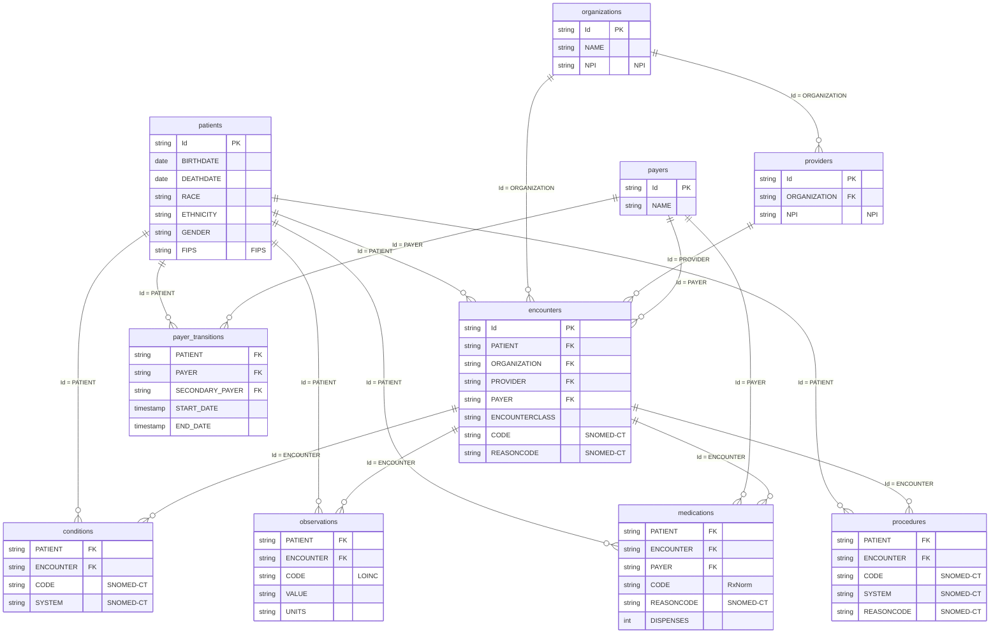

# Data sources

**Portfolio note.** Independent demonstration for Riverbend Community Health Network, a fictional safety-net network. The rows are synthetic. They are not evidence about real patients, and they are not a HEDIS or CMS submission.

**Checked.** 14 October 2026.

## Where the files are

The generator wrote the export to `data/synthea/`. An untouched clone of that folder is `data_raw/synthea/`. Cleaning in a later phase writes new tables. It does not edit either of these folders.

`data_raw/MANIFEST.sha256` records the size and hash of each raw CSV. Both copies are gitignored. They contain synthetic names, addresses, and Social Security numbers, which are still direct identifiers in shape.

The study warehouse is `warehouse/riverbend.duckdb`. It holds the ten tables in the model below. Claims, claim transactions, imaging studies, allergies, care plans, devices, immunizations, and supplies stay in the raw folder and in the data dictionary. They are not in the warehouse, because the two study measures are built from patients, encounters, conditions, observations, and medications.

## Source log

| Source | What was taken | URL | Accessed | License |
| --- | --- | --- | --- | --- |
| Synthea, version `d9d07a6`, jar `synthea-with-dependencies.jar` from the master-branch-latest release | CSV export for Massachusetts, seed 2026, clinician seed 2026, reference date 13 October 2026, 10 years of history, 2,000 living patients requested | https://github.com/synthetichealth/synthea | 14 October 2026 | Apache License 2.0. Copyright 2017-2025 The MITRE Corporation. https://github.com/synthetichealth/synthea/blob/master/LICENSE |
| Synthea CSV file data dictionary | Column meanings and code systems, checked against the headers in this export | https://github.com/synthetichealth/synthea/wiki/CSV-File-Data-Dictionary | 14 October 2026 | Same project wiki. Where a header disagrees with the wiki, the file wins and the dictionary says so. |

The run command and the metadata JSON are in `data/synthea/README.md` and `data/synthea/metadata/`.

Three differences from the wiki page on the access date:

- `payer_transitions` stores `START_DATE` and `END_DATE` as timestamps. The wiki still describes year columns named `START_YEAR` and `END_YEAR`.
- `organizations` and `providers` include `NPI`. The wiki page does not list it.
- `immunizations` names the cost column `BASE_COST`. The wiki calls it `Cost`.

## ROCCC

| Test | Judgment for this extract |
| --- | --- |
| Reliable | Not reliable evidence about real patients or real clinics. The seed makes the file reproducible. Internal keys are consistent enough to build a pipeline. |
| Original | Generated by Synthea. It is not an extract from an EHR, a payer, or CMS. |
| Comprehensive | Demographics, encounters, conditions, medications, observations, procedures, organizations, providers, and payer spans are present. Clinical notes, medication-administration times, and a problem list separate from the onset condition are not. |
| Current | Clinical rows stop on 13 October 2026. Measurement year 2026 does not contain November or December. The generator version is `d9d07a6`. |
| Cited | The project page, the license, the wiki dictionary, the seed, and the access date are in the source log. |

## License and privacy

The generator output may be used under Apache 2.0, with attribution to The MITRE Corporation. This repository does not commit the CSV files.

The file has no real protected health information. A production version of the same tables would. That version would sit inside the covered entity or under a business associate agreement. Access would be the minimum needed for this study: patient, encounter, condition, observation, medication, and organization keys, not the whole warehouse. Names, addresses, and Social Security numbers would be dropped before a dataset left the analyst's workspace. A research file that still held address or dates of birth would be a limited data set, with a data use agreement, or it would be de-identified before it moved. Queries against identified data would be audited. None of those controls are required for this synthetic copy, and none of them are optional once the source is real.

## How this compares with Epic Clarity

Epic Clarity is a relational database copied out of Chronicles for reporting. A single health system has thousands of tables: one structure for the problem list, another for the diagnoses coded on a contact, others for orders, results, medication administrations, and coverage. Standard codes sit behind Epic groupers and translation tables.

This export is eighteen flat files. A condition is one row dated at onset. An observation is one row with a LOINC code. A medication is a course with a dispense count, not a dose. There is no note table. The clinic grain is `organizations.Id`. This file contains 946 organizations across Massachusetts. It is not a panel of Riverbend clinics, and later clinic rates have to say that.

## Study data model

The diagram is the model for the quality study. Primary and foreign keys are marked. The code system is on each coded column. Tables without a primary key are event tables: one row is one clinical fact, joined through `PATIENT` and `ENCOUNTER`.

The full column list, including the eight raw tables that are outside this diagram, is `docs/synthea-data-dictionary.csv`.

## Warehouse

The case names BigQuery. On 14 October 2026, `bq` and `gcloud` were not on the path, and no sandbox project was configured. The ten study tables were loaded with `src/load_study_warehouse.py` into `warehouse/riverbend.duckdb`. That database is gitignored. Rebuild it from `data_raw/synthea/csv` rather than treating the DuckDB file as a source.

| Table | Rows |
| --- | ---: |
| patients | 2,285 |
| organizations | 946 |
| providers | 946 |
| payers | 10 |
| encounters | 127,672 |
| conditions | 79,827 |
| observations | 1,607,537 |
| medications | 103,106 |
| procedures | 355,243 |
| payer_transitions | 84,678 |

The generator metadata records 1,327 providers. The `providers` CSV has 946 rows, one for each organization. The CSV is the table this study uses.
